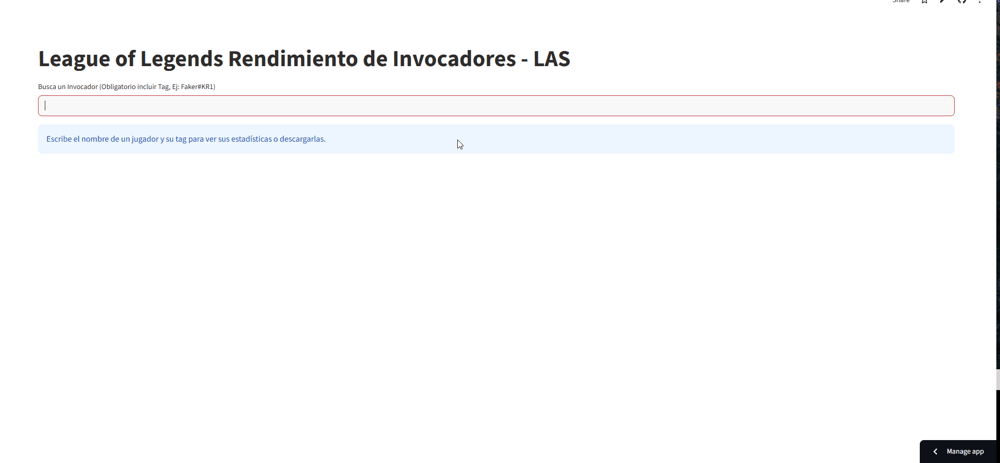

# League of Legends Incremental ETL & Data App

*(Read this in [English](README.md))*



**[🌍 App en Vivo: Prueba el ETL On-Demand aquí](https://pipeline-lol-etl-w7ypxneyrydcbqyxu9glmu.streamlit.app/?embed=true)**

Un proyecto de Ingeniería de Datos *End-to-End* que extrae estadísticas de partidas en vivo desde la API oficial de Riot Games, transforma datos JSON anidados, los carga en un Data Warehouse basado en la nube TiDB (MySQL) y los presenta a través de una interfaz interactiva inspirada en OP.GG.

Este proyecto demuestra un ciclo de vida completo de ingeniería de datos, centrado en arquitectura modular, manejo de límites de peticiones (rate-limits) de la API, modelado de datos relacionales y estrategias de **Carga Incremental** (Incremental Loading).

## Características Principales de Ingeniería de Datos

* **Pipeline ETL On-Demand:** En lugar de los tradicionales procesos *batch* programados, el pipeline se ejecuta dinámicamente a través de la interfaz de Streamlit. Si el jugador buscado no está en la base de datos, la aplicación extrae sus partidas recientes sobre la marcha.
* **Estrategia de Carga Incremental:** Para evitar la duplicación de datos y optimizar los límites de llamadas a la API, el pipeline cruza los `match_id` entrantes con los registros existentes en la base de datos, transformando e insertando únicamente las partidas nuevas.
* **Arquitectura Modular:** El código base está estrictamente desacoplado en módulos de extracción (`extract`), transformación (`transform`) y carga (`load`) dentro del directorio `src/`, siguiendo las mejores prácticas de ingeniería de software para escalabilidad.
* **Modelado de Datos:** Tabla de hechos (*Fact Table*) plana y lista para analítica (`fact_player_match_stats`), diseñada para soportar consultas rápidas y cálculo de métricas (Win Rate, KDA) sin *joins* complejos.
* **Gestión Segura de Secretos:** Las claves de la API y credenciales de la base de datos están completamente desacopladas del código fuente utilizando Streamlit Secrets y la inyección dinámica de variables de entorno del sistema operativo.
* **Alcance Regional (LAS):** El pipeline de datos y la analítica están actualmente optimizados y limitados al servidor de Latinoamérica Sur (LAS), demostrando restricciones de producto enfocadas y una entrega eficiente del MVP.

## Stack Tecnológico

* **Lenguaje:** Python 3.11+
* **Procesamiento de Datos:** Pandas
* **Base de Datos y ORM:** TiDB Serverless (Cloud DB compatible con MySQL), SQLAlchemy, PyMySQL
* **Interfaz y Visualización:** Streamlit, Plotly, HTML/CSS
* **API Origen:** Riot Games Developer API (Account-V1, Match-V5)

## Modelo de Datos Relacional

Los datos están estructurados en una Tabla de Hechos transaccional optimizada para analítica downstream (`fact_player_match_stats`):

| Columna | Tipo de Dato | Descripción |
| :--- | :--- | :--- |
| `match_id` | VARCHAR | Identificador único de la partida (ej. LA2_123456789) |
| `puuid` | VARCHAR | Identificador global único del jugador |
| `summoner_name` | VARCHAR | Riot ID y Tagline normalizado (ej. Jugador#LAS) |
| `champion_name` | VARCHAR | Campeón utilizado |
| `kills` / `deaths` / `assists` | INT | Estadísticas de combate base |
| `kda` | FLOAT | Métrica derivada: (Kills + Assists) / max(1, Deaths) |
| `total_damage` | INT | Daño total infligido a campeones |
| `win` | BOOLEAN | Resultado de la partida (1 = Victoria, 0 = Derrota) |

## Configuración y Despliegue Local

Para replicar este entorno de Ingeniería de Datos localmente:

1. **Clonar el repositorio:**
   ```bash
   git clone [https://github.com/Ncatalanv/pipeline-lol-etl.git](https://github.com/Ncatalanv/pipeline-lol-etl.git)
   cd pipeline-lol-etl
   ```

2. **Instlar Dependencias:**
   ```bash
   pip install -r requirements.txt
   ```

3. **Configurar entorno:**
   Crea una carpeta llamada `.streamlit` en la raíz del proyecto y agrega `secrets.toml`, la cual tienes que llenar con tus credenciales:
   ```toml
   [tidb]
   host = "your-tidb-host.cloud"
   port = 4000
   database = "lol_analytics"
   username = "your-username"
   password = "your-password"

   [riot]
   api_key = "RGAPI-your-developer-api-key"
   ```

4. **Ejecutar la Aplicación:**
   ```bash
   streamlit run app.py
   ```